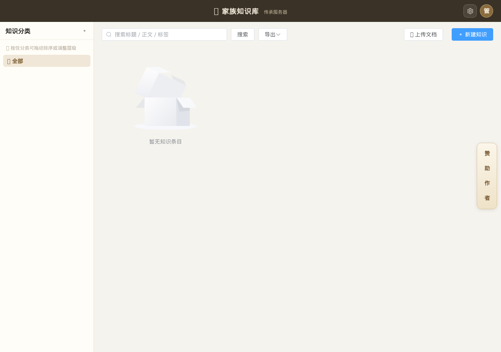
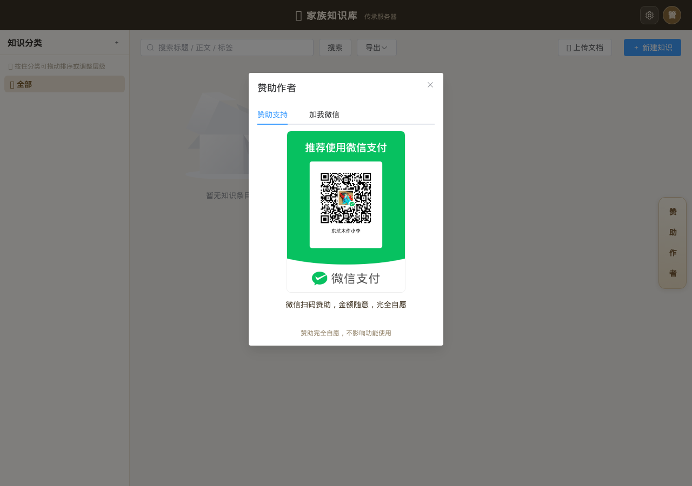

**仓库：** `knowledge`　**许可证：MIT**

# 家族知识库（传承服务器）

家族文档/资料知识管理系统：分类、条目、附件在线预览、全文检索、版本历史、回收站、导入导出，可与族谱系统单点登录集成。

## 功能

- 知识分类、条目、标签、相关条目
- PDF/Office 附件在线预览
- 中文全文检索（FTS5/trigram）
- 版本历史、回收站、导入/导出
- 用户/角色/审计日志
- 与族谱系统 SSO；纯本地部署

## 截图




## 快速开始

### Docker

```yaml
services:
  knowledge:
    image: alpine:3.21
    container_name: knowledge
    ports: ["8090:8090"]
    environment:
      KB_DATA_DIR: /data
      KB_PORT: "8090"
      KB_ADMIN_USER: admin
      KB_ADMIN_PASS: admin123
    volumes:
      - ./data:/data
      - ./web:/app/web:ro
      - ./knowledge:/app/knowledge:ro
    entrypoint: ["/app/knowledge"]
```

默认端口 **8090**，初始账号 `admin / admin123`。

### fnOS fpk

使用 `安装包/知识库/...-fnos.fpk`；默认端口 8090，安装向导/配置可改。

## 构建

```bash
cd frontend && pnpm install && pnpm build
cd ..
CGO_ENABLED=1 CC=musl-gcc go build -tags sqlite_fts5 -trimpath \
  -ldflags "-linkmode external -extldflags -static -s -w" -o knowledge .
```

- 无 garble / 加壳；
- SQLite + FTS5 需要 CGO，使用 `CGO_ENABLED=1` + musl 静态；
- 前端 `pnpm build` 产物放 `web/`。

## 数据与隐私

- 纯本地部署，数据不上传云端；
- 附件、数据库、备份由用户掌控；
- 生产环境请修改默认密码、配置 HTTPS。

## 赞助

| 赞助支持 | 加我微信 |
|---|---|
|  |  |

赞助完全自愿，不影响功能使用。

## 关于我们

本系统由业余爱好者利用工作之余独立开发维护，功能迭代或有延迟，还望海涵。纯本地部署，数据只存在您自己的服务器上，绝不上传云端。

## 声明

- 业余维护，不保证 SLA；
- 使用前请自行备份数据；
- 生产环境请修改默认密码并配置 HTTPS。

## 许可证

本项目采用 **MIT** 许可证，详见 [LICENSE](LICENSE)。

> 说明：赞助二维码为开发者本人所有，二次开发者请自行替换。
